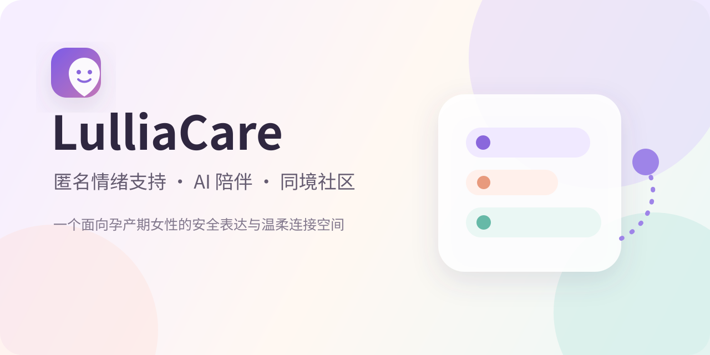
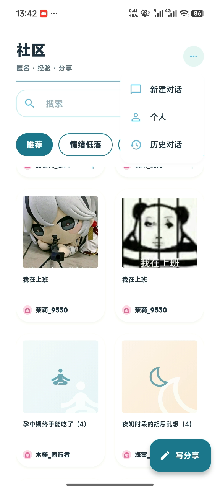

<p align="center">
  
</p>

<h1 align="center">LulliaCare 产品作品集</h1>

<p align="center">
  面向孕产期女性的 AI 协作型匿名互助社区<br />
  从私密表达出发，帮助用户找到相似处境下的真实回应
</p>

<p align="center">
  <a href="#产品作品集导航">产品文档</a> ·
  <a href="docs/产品作品集/02-竞品分析与机会判断.md">竞品分析</a> ·
  <a href="docs/产品作品集/03-MVP需求文档.md">MVP PRD</a> ·
  <a href="assets/demo/LulliaCare-产品演示.mp4">产品演示</a> ·
  <a href="#技术落地">技术落地</a>
</p>

> 本仓库以产品岗位作品集为主，重点展示问题定义、用户洞察、竞品研究、需求设计、产品取舍、指标与评测、上线规划。技术内容保留在后半部分，用于说明产品方案已经形成可运行原型。

## 产品概览

| 项目 | 内容 |
|---|---|
| 产品定位 | AI 协作型匿名孕产互助社区 |
| 目标用户 | 备孕、孕期、产后及育儿早期，存在情绪表达与同伴支持需求的女性 |
| 用户问题 | 想表达但有隐私顾虑；信息很多却难获可信回应；通用 AI 缺少真实同伴关系 |
| 核心方案 | AI 帮助表达和匿名化，系统匹配相似处境，小组与社区提供真实回应 |
| 核心假设 | 用户在私密倾诉后，愿意接受 AI 辅助发帖或小组推荐，并继续参与真实互动 |
| 差异化 | AI 情绪入口 + 匿名 UGC + 相似处境分发 + 小组关系沉淀 |
| 当前阶段 | 可运行 MVP 与产品原型，持续验证核心闭环 |

## 产品演示

<p align="center">
  <a href="assets/demo/LulliaCare-产品演示.mp4">
    
  </a>
</p>

<p align="center"><strong>点击图片观看约 64 秒产品演示</strong></p>

演示覆盖登录、AI 角色与对话、社区浏览、创建小组和小组交流。视频使用测试账号和虚构内容；其中“轻音”是项目早期原型名称，现统一使用 LulliaCare。

## 产品问题与洞察

孕产阶段会持续出现大量不确定时刻：身体变化、产检、睡眠、生产恐惧、伴侣沟通、产后恢复与育儿压力。它们不一定每次都需要医疗介入，但用户仍然需要被理解、被验证和获得同境支持。

现有方案各自存在缺口：

| 现有方案 | 能解决什么 | 仍然缺少什么 |
|---|---|---|
| 孕期工具 | 记录、提醒、知识查询 | 情绪承接与持续关系 |
| 母婴社区 | 大量真实经验 | 信息筛选、隐私与焦虑治理 |
| 公开内容平台 | 丰富内容与传播 | 脆弱表达的安全感 |
| 微信群 | 真实互动 | 低门槛加入、隐私、搜索和沉淀 |
| 通用 AI | 即时回答与陪伴 | 孕产上下文、真实经验和关系网络 |

因此 LulliaCare 不把 AI 设计成替代真人的“万能朋友”，而是把它定位为 **Social Copilot**：帮助用户表达、匿名化、匹配、分发、总结和治理，最终支持仍然来自真实的人。

## 核心用户旅程

```text
用户产生处境或情绪
    ↓
AI 帮助表达、整理和匿名化
    ↓
用户确认是否进入下一步
    ├── 生成可编辑社区草稿
    └── 推荐相似处境小组
    ↓
真实用户提供回应与经验
    ↓
AI 辅助总结、提醒和继续连接
```

## 产品特色

### 1. AI 是协作引擎，不是关系终点

AI 负责降低表达与匹配门槛，不替代真人经验。产品价值不止是“聊完舒服一点”，而是把私密倾诉转化为可持续的真实支持关系。

### 2. 采用化名制，而不承诺绝对匿名

前台以化名、匿名号和头像标识出现，后台保留必要的身份映射和治理能力。这样既减少表达压力，也保留内容追溯与安全治理空间。

### 3. 社区不是热闹广场，而是处境分发

分发目标不是获得最大流量，而是让脆弱表达被最可能理解的人看到。推荐依据包括孕产阶段、困扰标签、历史表达与互动行为。

### 4. 小组先允许围观，再鼓励表达

用户可以先只读，确认氛围和边界后再加入。小组采用异步留言而不是强实时聊天室，降低冷启动压力和治理成本。

### 5. 用“轻回应”替代泛化点赞

“我也有过”“抱抱你”“想听后续”等回应更符合情绪支持语境，让用户无需组织完整语言，也能表达“我看见你了”。

### 6. AI 只能生成草稿，发布权始终属于用户

无论社区发帖、开场白还是小组消息，AI 结果都必须经过用户查看、编辑和确认，不能自动公开用户的私密表达。

## 产品作品集导航

| 产品产出 | 重点展示 | 文档 |
|---|---|---|
| 产品定位与策略 | 用户问题、价值主张、差异化、产品边界 | [公开版产品定位](docs/产品作品集/01-产品定位与策略.md) · [原始产品手册 PDF](docs/产品作品集/原始文档/LulliaCare-产品手册.pdf) |
| 竞品分析 | PEST、竞品选择、商业模式、KANO、SWOT、机会判断 | [分析摘要](docs/产品作品集/02-竞品分析与机会判断.md) · [完整竞品报告 PDF](docs/产品作品集/原始文档/轻音-竞品分析报告.pdf) |
| MVP PRD | 核心假设、范围、主流程、非目标、验收思路 | [公开版 MVP PRD](docs/产品作品集/03-MVP需求文档.md) |
| 社区模块 | 信息架构、搜索、标签、内容卡片、AI 草稿发布 | [社区模块设计](docs/产品作品集/04-社区模块设计.md) |
| 同境小组 | 推荐、围观、开场白、异步互动、轻回应 | [同境小组产品设计](docs/产品作品集/05-同境小组产品设计.md) |
| 指标与评测 | 漏斗、质量指标、安全红线、人工评测 | [产品指标与评测](docs/产品作品集/06-产品指标与评测.md) |
| 上线与迭代 | 软启动、合规前置、阶段计划、风险管理 | [上线与迭代规划](docs/产品作品集/07-上线与迭代规划.md) |

> 原始材料中包含团队协作、内部批注或开发信息的文档，未直接公开；仓库收录的是适合作品集展示的脱敏版本。竞品数据与政策信息均有时间截点，使用前需重新核验。

## 竞品分析结论

竞品研究没有寻找一个“完全相同”的直接竞品，而是拆解 LulliaCare 需要连接的三段能力：

- 美柚：女性垂直社区、工具到社区及商业化生态；
- 脉脉：匿名内容、情绪共鸣与群组关系机制；
- 猫箱：AI 角色作为情绪入口的体验与商业可行性旁证。

核心判断是：LulliaCare 的机会不在单点功能，而在三段链路的衔接——**私密情绪 → AI 辅助表达 → 匿名内容 → 同境关系**。主要风险则是链路过长、社区冷启动困难、内容治理失控和缺少高频打开钩子。

因此 MVP 不一次性铺满所有能力，而是优先验证最小闭环：

```text
AI 倾听与整理 → 用户确认匿名发布 → 获得真实共鸣回应
```

## MVP 范围与取舍

### 本期重点

- 状态标签与匿名身份；
- 多角色 AI 对话；
- AI 生成可编辑帖子草稿；
- 社区浏览、搜索与标签筛选；
- 同境小组推荐、围观、加入与轻回应；
- 内容安全、举报与用户记忆控制。

### 主动暂缓

- 好友与通讯录关系；
- 复杂评论和楼中楼；
- 公开私聊和泛社交匹配；
- 完整商业化体系；
- 未经验证的大规模推荐算法。

取舍原则是先验证“用户是否愿意从私密表达走向真实共鸣”，而不是先堆叠社交功能。

## 指标与验证框架

产品指标围绕核心漏斗设计：

```text
开始 AI 对话
  → 达到有效对话
  → 看见发帖或小组建议
  → 点击并确认
  → 发布 / 加入 / 围观
  → 收到真实回应
  → 再次表达或次日回访
```

除转化指标外，产品还关注页面成功率、加载时间、发布成功率、内容安全拦截、AI 输出质量、隐私去除和高风险路径是否正确分流。详细定义见 [产品指标与评测](docs/产品作品集/06-产品指标与评测.md)。

## 隐私与安全

LulliaCare 涉及孕产和心理健康，安全是产品设计约束，不是附加功能：

- 医疗风险和高危情绪优先进入安全提示，不走普通社区推荐；
- AI 和社区内容不提供诊断或治疗结论；
- 用户明确知道哪些信息公开、哪些只在小组内出现；
- AI 改写与记忆均由用户控制；
- 社区对隐私泄露、联系方式交换、攻击、错误医疗建议进行审核；
- 公开展示只使用测试数据，不包含真实用户信息。

详见 [隐私与安全说明](docs/隐私与安全.md)。

## 技术落地

产品原型已形成移动端、后端、数据库与 AI 编排的完整链路。技术部分放在产品内容之后，用于说明核心方案具备可实现性。

<p align="center">
  
</p>

| 层级 | 技术与作用 |
|---|---|
| 移动端 | Flutter、Dart、Material、gen-l10n、状态持久化 |
| API | FastAPI、Pydantic、统一鉴权与响应 |
| AI | LangGraph、安全分流、角色回复、三层记忆、模型适配层 |
| 数据 | MySQL、SQLAlchemy、Alembic、Redis |
| 质量 | Flutter Test、静态分析、Pytest、人工评测方案 |
| 本地环境 | Docker Compose 一键启动数据库、缓存和后端 |

工程实现重点包括：模型厂商解耦、高风险输入前置分流、用户可查看和清除记忆、Redis 故障时主链路降级、数据库迁移与可替换的移动端 API 网关。

更多内容见 [技术架构说明](docs/技术架构.md)。

## 当前验证

- Flutter 静态分析 0 个问题；
- 20 项 Flutter 自动化测试通过；
- FastAPI、MySQL 与 Redis 本地容器健康；
- 健康接口确认数据库与缓存连接正常；
- 产品侧已形成竞品研究、MVP PRD、社区方案、同境小组方案、人工评测与上线规划。

## 公开说明

本仓库是 LulliaCare 的公开产品作品集。源代码分别维护在移动端和后端仓库中，公开前会先完成密钥、提交历史和素材授权检查。面试评审需要查看源码时，可以联系项目维护者获取授权。

本展示仓库保留所有权利，公开可见不代表授予开源许可，详见 [LICENSE](LICENSE)。

