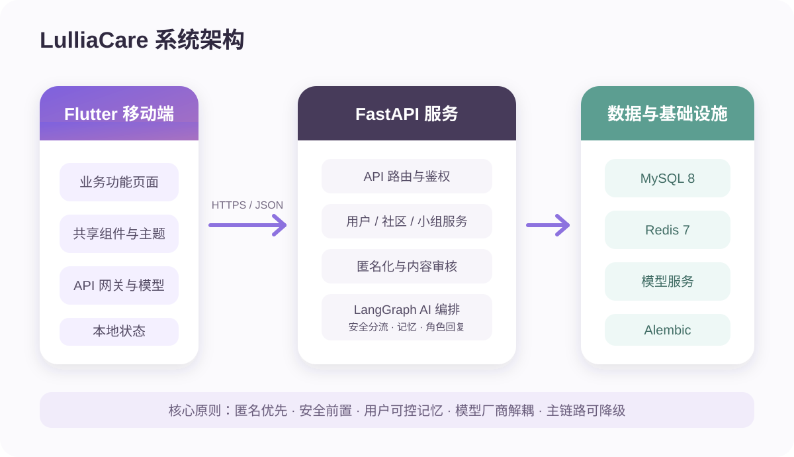

<p align="center">
  
</p>

<h1 align="center">LulliaCare</h1>

<p align="center">
  面向孕产期女性的匿名情绪支持产品：以 AI 陪伴为入口，连接社区表达与同境小组。
</p>

<p align="center">
  <a href="https://github.com/LulliaCare/LulliaCare-APP">移动端源码</a> ·
  <a href="https://github.com/LulliaCare/LulliaCare-Backend">后端源码</a> ·
  <a href="docs/项目介绍.md">项目介绍</a> ·
  <a href="docs/技术架构.md">技术架构</a> ·
  <a href="docs/面试导览.md">面试导览</a>
</p>

> 当前版本为可运行的 MVP 与工程原型，用于验证匿名身份、AI 情绪陪伴、跨会话记忆、社区内容和同境小组等核心链路。它不提供医疗诊断，也不能替代专业医疗或紧急援助。

## 一分钟了解项目

| 项目 | 内容 |
|---|---|
| 服务对象 | 处于备孕、孕期、产后与育儿早期的女性 |
| 核心问题 | 情绪难以被理解、表达压力高、真实身份顾虑、同境支持难匹配 |
| 产品方案 | 匿名身份 + 多角色 AI 陪伴 + 匿名社区 + 同境小组 |
| 移动端 | Flutter 3.44.3，支持中英文、真实 API、会话状态持久化 |
| 后端 | FastAPI、SQLAlchemy、MySQL、Redis、LangGraph、Alembic |
| 当前验证 | Flutter 静态检查 0 问题；20 项自动化测试通过；后端健康检查通过 |

## 演示

演示视频与移动端截图正在整理，最终会放在本节最显眼的位置。现阶段可以先查看：

- [演示截图准备清单](assets/截图/README.md)
- [完整用户旅程](docs/项目介绍.md#核心用户旅程)
- [本地运行方法](#本地运行)

> 视频发布方案：仓库保留一张带播放按钮的封面图，点击后进入公开视频页面；避免把大体积视频直接提交进 Git 历史。

## 产品核心

### 1. 低门槛匿名身份

首次使用通过设备标识换取匿名身份与 JWT，无需立即提交手机号或真实姓名。前台只展示匿名昵称、匿名号与头像标识。

### 2. 多角色 AI 陪伴

提供“知心闺蜜”“过来人”“咨询师”三种陪伴角色。后端使用 LangGraph 编排上下文、安全判断、意图识别、角色回复与行动建议。

### 3. 可解释的跨会话记忆

对话采用会话摘要、关键事实与用户画像三层记忆。用户可以查看或清空“AI 记得我的内容”，降低黑盒感。

### 4. 从倾诉到社区表达

AI 可以把对话中的经历整理成可编辑草稿；用户确认后再发布到匿名社区。自由发帖与 AI 辅助发帖均经过内容安全检查。

### 5. 同境小组

根据状态标签和对话共鸣推荐小组，支持正式加入、只读围观、轻回应、举报与内容审核，减少直接社交压力。

## 技术架构

<p align="center">
  
</p>

```text
Flutter App
    │ HTTPS / JSON / Bearer Token
    ▼
FastAPI API 层
    │
    ├── 用户、社区、小组等业务服务 ── MySQL 8
    ├── AI 编排与安全分流 ───────── LangGraph / 模型适配层
    ├── 埋点与降级队列 ─────────── Redis
    └── 数据库版本管理 ─────────── Alembic
```

更多内容见 [技术架构说明](docs/技术架构.md)。

## 工程亮点

- **前后端真实联调**：移动端通过统一网关接入用户、标签、角色、聊天、帖子与个人资料 API。
- **模型厂商解耦**：AI 访问通过 Provider 抽象，可切换 OpenAI 兼容服务、DeepSeek、Qwen 或本地模型。
- **安全优先的 AI 流程**：高风险与紧急输入先经过安全节点，不进入普通角色回复链路。
- **隐私数据最小化**：匿名身份与真实设备标识分层；社区和小组只暴露化名数据。
- **可恢复的会话状态**：设备 ID、Token、角色和活跃会话在本地持久化，失效状态可自动恢复。
- **可测试性**：Flutter 通过网关边界替换后端依赖，覆盖启动、认证、引导、聊天、社区、小组和个人中心流程。
- **可迁移部署**：数据库结构由 Alembic 维护，图片存储与模型服务均预留替换边界。

## 技术栈

| 层级 | 技术 |
|---|---|
| 移动端 | Flutter、Dart、Material、gen-l10n、shared_preferences |
| API | FastAPI、Pydantic、Uvicorn |
| AI | LangGraph、LangChain、可插拔 Model Provider |
| 数据 | MySQL 8、SQLAlchemy 2.0、Alembic、Redis 7 |
| 工程化 | Docker Compose、Pytest、Flutter Test、静态分析 |

## 安全与产品边界

LulliaCare 处理的是敏感情绪表达，因此安全不是附加功能，而是核心设计约束：

- 对高风险输入进行分级与阻断，优先展示安全资源；
- 对联系方式、身份泄露、辱骂、医疗建议和违法内容进行场景化审核；
- 用户可以查看和清除 AI 记忆；
- 项目不宣称提供诊断、治疗或紧急救援；
- 公开展示仓库不包含真实用户数据、API Key、数据库文件或生产配置。

详见 [隐私与安全说明](docs/隐私与安全.md)。

## 本地运行

完整项目由两个源码仓库组成：

```bash
git clone https://github.com/LulliaCare/LulliaCare-APP.git
git clone https://github.com/LulliaCare/LulliaCare-Backend.git
```

后端可通过 Docker Compose 启动；移动端需要 Flutter 3.44.3 或兼容版本。详细步骤分别见：

- [移动端运行说明](https://github.com/LulliaCare/LulliaCare-APP#本地运行)
- [后端运行说明](https://github.com/LulliaCare/LulliaCare-Backend#快速开始)

## 项目状态

| 能力 | 状态 |
|---|---|
| 匿名初始化与 JWT | 已完成 |
| AI 角色与真实对话 API | 已完成 |
| 三层记忆与用户可清除 | 已完成 |
| 社区浏览与 AI 发帖草稿 | 已完成 |
| 同境小组后端能力 | 已完成，移动端持续对齐 |
| 正式账号体系 | 规划中 |
| 评论与收藏 | MVP 暂不包含 |
| 图片内容审核与对象存储 | 预留接口，规划中 |

## 仓库导航

- [移动端源码：LulliaCare-APP](https://github.com/LulliaCare/LulliaCare-APP)
- [后端源码：LulliaCare-Backend](https://github.com/LulliaCare/LulliaCare-Backend)
- [产品与用户旅程](docs/项目介绍.md)
- [技术架构与关键设计](docs/技术架构.md)
- [隐私与安全](docs/隐私与安全.md)
- [面试导览](docs/面试导览.md)

## 说明

本仓库是 LulliaCare 的公开展示入口，重点呈现产品思考、技术架构与工程实践。源代码分别维护在移动端和后端仓库中。

本展示仓库保留所有权利，公开可见不代表授予开源许可，详见 [LICENSE](LICENSE)。

